<div align="center">


# GMCP: safe MCP servers for AI coding agents

-- Live Demo : https://gmcp.outrightcrm.in/app/ --

**Let Claude Code, Codex and Cursor work in GitHub, Jira and your tests, with guardrails, human approvals and a full audit log.**

[Live demo](https://gmcp.outrightcrm.in/app/) · [Features](#features) · [Run locally](#run-locally) · [Live backend mode](#live-backend-mode) · [Project structure](#project-structure)

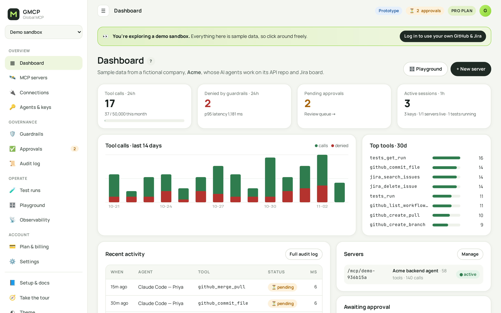

</div>

## What it is

GMCP sits between AI coding agents and the tools they work in. Instead of handing an agent your GitHub token and hoping for the best:

- **Each agent gets its own key**, scoped to `read`, `write` or `admin`, with expiry and one-click revoke.
- **Guardrail policies decide every call**: tool allow-lists, allowed repos and Jira projects, protected branches, rate limits. The first matching rule wins.
- **Risky actions wait for a person**: merges, deletes and writes to protected branches land in an approval queue.
- **Everything is logged**: input, output, actor, decision, rule and latency, exportable and streamable to OpenTelemetry.

This repository is the **React frontend / clickable prototype**. It runs in two modes:

| Mode | When | Data |
|---|---|---|
| **Demo** (default) | No backend configured, e.g. GitHub Pages | A realistic in-browser sandbox (fictional company "Acme"): 58 real tool definitions, 3 agents, two weeks of activity, approvals and test runs. Guardrails are evaluated by the same rules engine as the backend. |
| **Live** | `VITE_GMCP_API_URL` is set | Talks to the GMCP PHP backend (real GitHub / Jira / CI calls, MCP endpoint at `/mcp/<server>`). |

## Live demo

After you push to GitHub and enable Pages (see [Deploy](#deploy-to-github-pages)), the demo is published at:

`https://<your-user>.github.io/<repo-name>/`

Pick **Explore as a guest** for a read-mostly sandbox, or **Log in** with any username and password to try owner features such as adding connections. In demo mode nothing leaves the browser: state is kept in `localStorage`, and **Settings → System → Reset demo data** starts over.

## Features

| | |
|---|---|
| 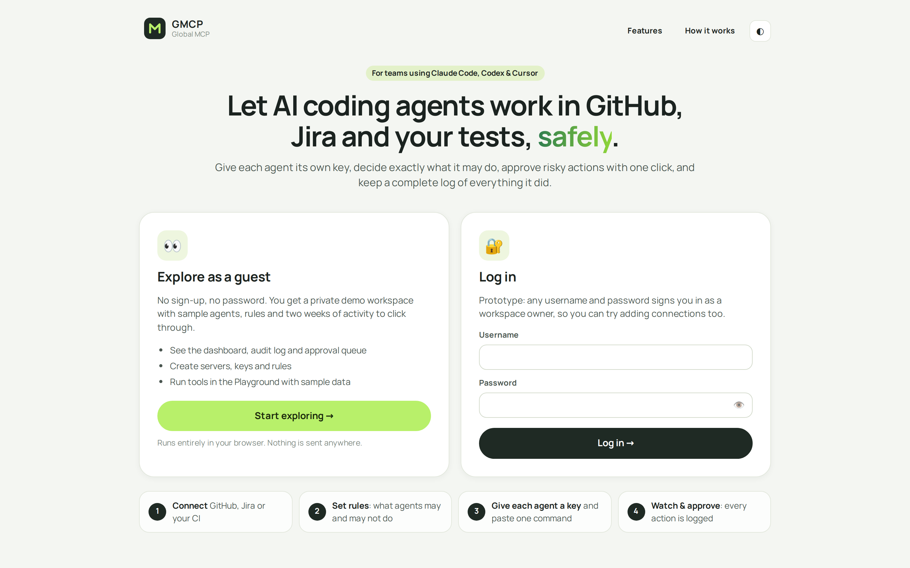 **Landing page:** choose guest or login | 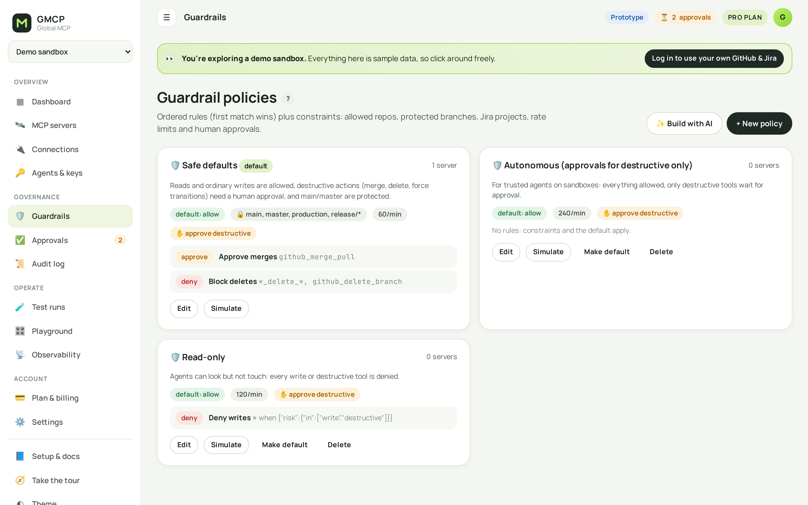 **Guardrails:** ordered rules + constraints, AI policy builder |
| 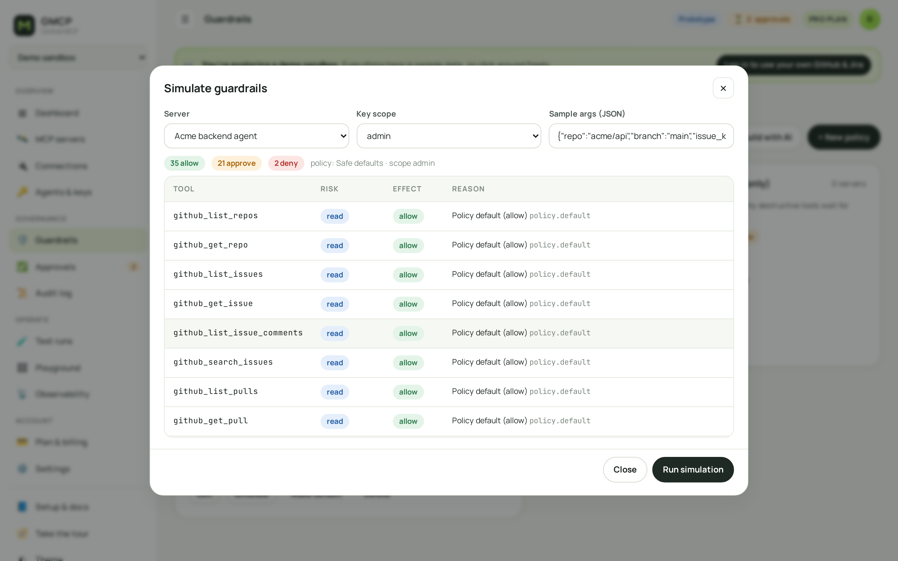 **Simulator:** allow / approve / deny for every tool before you ship a policy | 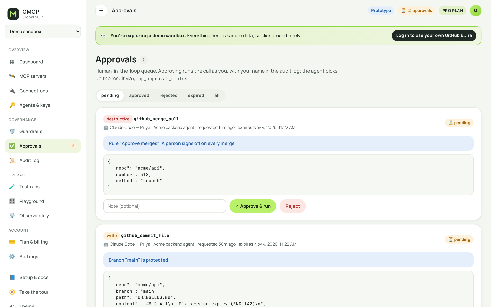 **Approvals:** human-in-the-loop queue |
| 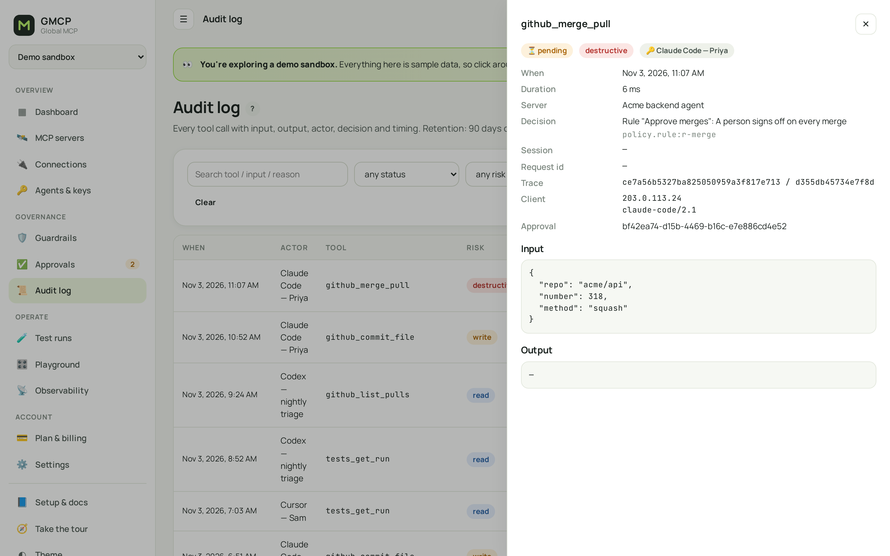 **Audit log:** every call with full input/output and the deciding rule | 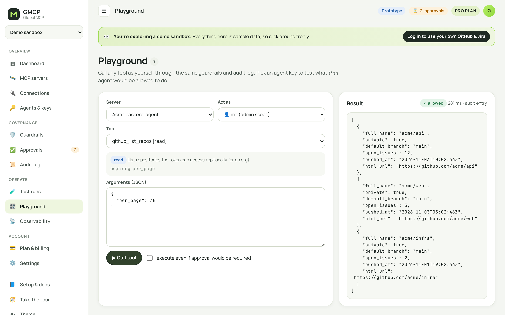 **Playground:** run any tool as yourself or as an agent key |
| 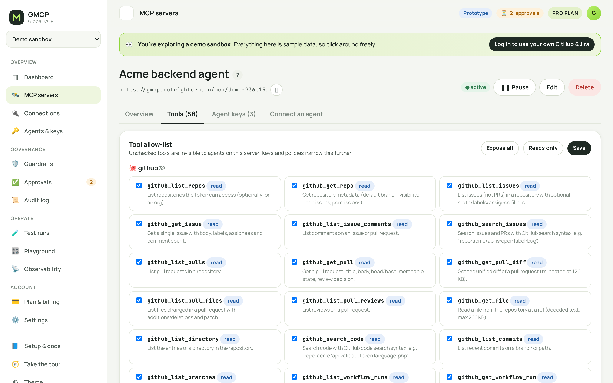 **Per-server tool allow-list** | 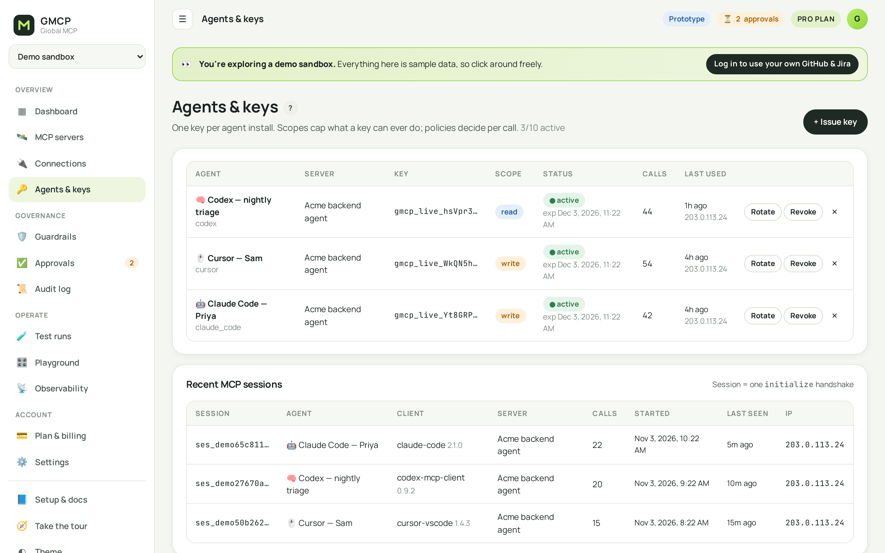 **Agent keys & MCP sessions** |
| 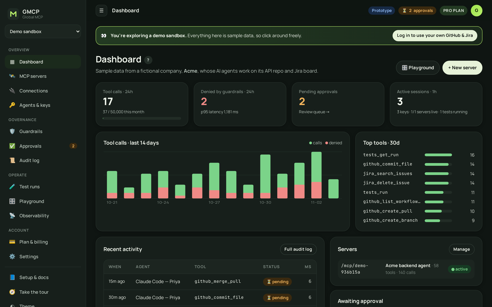 **Dark mode** | 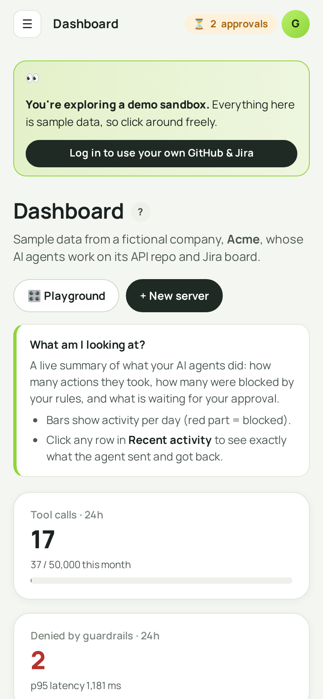 **Responsive** |

Also included: a first-visit tour, a "?" help box on every page, an observability page (OpenTelemetry export, webhooks), plans and usage meters, settings, and connection snippets for Claude Code, Codex, Cursor, Windsurf and the Claude Agent SDK. Roadmap items (GitLab, Linear, Slack, Sentry, self-hosted runners, SSO, card checkout) are shown in the UI as **Coming soon**.

## Run locally

Requires Node 18+ (20 recommended).

```bash
npm install
npm run dev          # http://localhost:5173
```

Other scripts:

```bash
npm run build        # type-check + production build into dist/
npm run preview      # serve dist/ on http://localhost:4173
npm run typecheck
npm run screenshots  # regenerate docs/screenshots (needs `npx playwright install chromium` once, and `npm run preview` running)
```

## Live backend mode

The backend is the GMCP PHP module (part of the OutrightCRM install at `custom/gmcp/`). To run this UI against it:

1. Copy `.env.example` to `.env` and set:
   ```env
   VITE_GMCP_API_URL=/index.php?entryPoint=gmcp_api
   ```
2. `npm run build` and serve `dist/` **from the same origin as the backend** (for example `https://gmcp.example.com/app/`), so the session cookie and CSRF token work. The build uses relative paths and works from any sub-folder.

On the server that hosts the backend, one command builds the live version and publishes it to `<crm>/app/` (atomic swap, cache headers included):

```bash
CRM_ROOT=/path/to/crm npm run deploy:crm     # → https://<crm-host>/app/
```

The live instance runs at **https://gmcp.outrightcrm.in/app/**.

The API is a single JSON endpoint: `POST {"action": "servers.list", ...}` with an `X-GMCP-Token` header; `GET ?csrf=1` returns the token. The demo backend in `src/api/demo/backend.ts` implements the same actions and response shapes.

## Deploy to GitHub Pages

1. Push this repo to GitHub.
2. **Settings → Pages → Build and deployment → Source: GitHub Actions**.
3. Every push to `main` runs `.github/workflows/deploy-pages.yml` and publishes the demo. `ci.yml` type-checks and builds every push and PR.

Routing uses `HashRouter` (`/#/app/dashboard`), so deep links work on Pages without server rewrites.

## Project structure

```
src/
  api/
    client.ts            api(action, data): demo or live, same call everywhere
    demo/backend.ts      in-browser implementation of the GMCP API
    demo/policy.ts       guardrail engine (port of the backend's Policy.php)
    demo/catalog.json    58 tool definitions + connection types (exported from the backend)
    demo/seed.json       demo sandbox data (generated by the backend's demo seeder)
  components/            layout, session, modal/drawer/toast primitives
  pages/                 one file per screen
  styles/app.css         design tokens (light + dark) and components
scripts/screenshots.mjs  README screenshot generator (Playwright)
scripts/deploy-crm.sh    build LIVE mode and publish to <crm>/app/
.github/workflows/       CI + GitHub Pages deploy
```

## Tech

React 18 · TypeScript · Vite 5 · React Router 6 · no UI framework (hand-written CSS with design tokens) · Playwright for screenshots.
